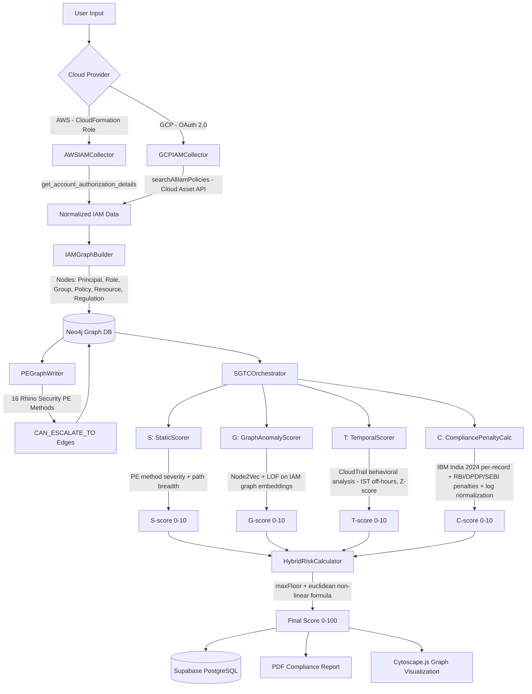
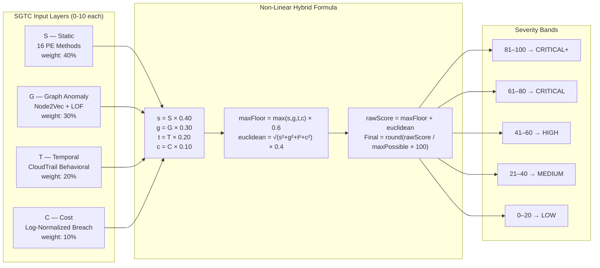
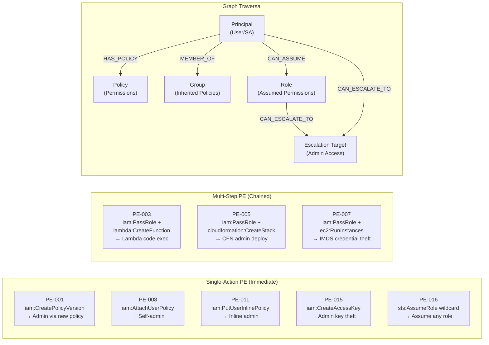
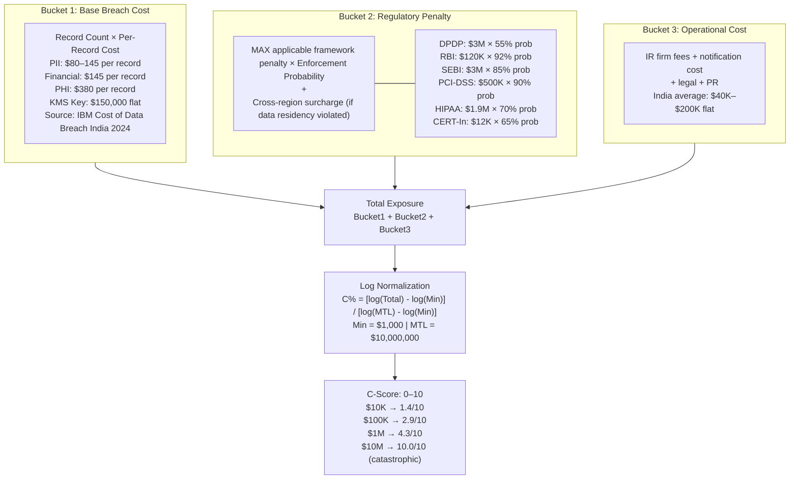

# AuthMap — IAM Attack Path & Cost Compliance Analyzer

> **Find the hidden paths attackers use to escalate from any IAM principal to full admin access — before they do and quantify the financial and regulatory impact in Indian compliance context.**


Technical Report : [Technical Report](https://github.com/devjoshi2005/AuthMap/blob/main/technicalreport.md)

[Video](https://github.com/user-attachments/assets/93108ef7-f17b-4b82-b059-e4cf3a38c717)


---


## What Problem Does This Solve?

### The Scenario

Your company runs on AWS or GCP. You have hundreds of IAM users, roles, service accounts, and policies. You think your access controls are fine — but are they?

Consider this: a junior automation engineer named `carol-automation` has `iam:PassRole` and `lambda:CreateFunction` permissions. Individually, these seem harmless. Combined, she can create a Lambda function, attach an admin role to it via PassRole, invoke it, and extract admin credentials from the execution environment — **all without triggering a single GuardDuty alert**.

This is a **privilege escalation attack path**. It exists silently in the majority of AWS environments. It is not visible in the AWS Console. It is not detected by native security tools. And it directly violates SOC 2, RBI, DPDP, and PCI-DSS controls.

### The Cost of Not Finding It

- **65% of cloud breaches** originate from compromised or misconfigured credentials (IBM, 2024)
- **Average breach cost in India**: ₹195 million ($2.35M) — a 9% increase year-over-year
- Regulatory penalties under Indian law: DPDP Act ₹250 Cr, RBI up to ₹10 Cr per violation, SEBI up to ₹250 Cr
- Manual IAM review of a 200-user environment takes a qualified engineer **40+ hours** and still misses multi-hop attack chains

**AuthMap automates what is otherwise impossible to do manually at scale.**

---

## How AuthMap Works — The Analogy

Think of your IAM environment as a building with thousands of locked rooms (resources) connected by doors (permissions). Every user holds a keyring (policy set). Some users, through a combination of keys, can unlock a master door (admin access) — even if no single key on their ring opens it directly.

AuthMap:
1. **Maps every door and keyring** in the building using cloud APIs
2. **Finds every path** from any user to the master door using graph traversal
3. **Scores the danger** of each path based on how many steps, what's blocked, and what data is at risk
4. **Prices the breach** using IBM India 2024 per-record costs + applicable Indian regulatory penalties
5. **Reports findings** in compliance-ready format for SOC 2, RBI, DPDP, and 7 other frameworks

---

## Architecture Overview



---

## SGTC Risk Scoring Engine

AuthMap scores every IAM principal using four independent layers combined through a **non-linear hybrid formula** that ensures a single critical finding dominates the score — not gets diluted by clean scores elsewhere.



**Why non-linear?** If `carol-automation` has a single CRITICAL PE path (S=10) but low graph anomaly and no unusual temporal patterns, the linear formula gives her a diluted score of ~4/10. The euclidean component ensures she scores **73/100 — correctly flagged as CRITICAL** based on that single dangerous capability.

---

## Privilege Escalation Detection — 16 Methods

AuthMap implements all 16 privilege escalation methods documented by Rhino Security Labs, adapted for modern AWS environments:



---

## Breach Cost Calculation



---

## Compliance Framework Coverage

| Framework | Regulator | Max Penalty | Enforcement | Data Residency | Applies To |
|-----------|-----------|-------------|-------------|----------------|------------|
| **DPDP Act 2023** | Data Protection Board of India | ₹250 Cr ($3M) | 55% | No | All |
| **RBI Cybersecurity Framework** | Reserve Bank of India | ₹10 Cr + ₹30 Cr cross-border | 92% | Yes (ap-south-1/2) | Fintech, NBFC, Bank |
| **SEBI CSCRF 2024** | Securities and Exchange Board of India | ₹250 Cr ($3M) | 85% | Yes | Broker, Exchange, MF |
| **IRDAI Guidelines 2023** | Insurance Regulatory Authority | ₹5 Cr ($60K) | 70% | Yes | Insurance, TPA |
| **CERT-In Directions 2022** | Ministry of Electronics and IT | ₹1 Cr ($12K) | 65% | No | All (6-hr reporting) |
| **IT Act 2000** | Adjudicating Officers + Courts | ₹10 Cr civil | 40% | No | All |
| **PCI-DSS v4.0** | PCI SSC / Card Networks | $500K + $90/card | 90% | No | Payment processors |
| **HIPAA** | HHS Office for Civil Rights | $1.9M/year | 70% | Yes (US regions) | Healthcare BPO |
| **SOC 2** | AICPA / Enterprise contracts | $500K lost ARR | 75% | No | B2B SaaS |
| **ISO 27001:2022** | Certification Bodies | $200K lost tenders | 60% | No | All |

---

---


## Key Components

### Collection Layer

| Component | What It Does | API Used |
|-----------|-------------|----------|
| **AWSIAMCollector** | Collects users, roles, groups, policies, trust relationships | `get_account_authorization_details` (single paginated call) |
| **GCPIAMCollector** | Collects all IAM policy bindings across project | `searchAllIamPolicies` via Cloud Asset API |

### Graph Layer

| Component | What It Does |
|-----------|-------------|
| **IAMGraphBuilder** | Creates Neo4j nodes (Principal, Role, Group, Policy, Resource, Regulation) and edges |
| **PEGraphWriter** | Evaluates 16 PE methods, writes `CAN_ESCALATE_TO` edges with method + severity |
| **AttackPathFinder** | Cypher queries for CRITICAL path extraction, blast radius calculation then checks semantically for (admin,overpirivilege & dormant IAM credentials) |

### Intelligence Layer

| Component | Algorithm | What It Detects |
|-----------|-----------|-----------------|
| **StaticScorer** | 16 rule-based PE method checks | Known privilege escalation patterns |
| **GraphAnomalyScorer** | Node2Vec (32-dim) + Local Outlier Factor | Structurally anomalous principals — ghost admins, isolated bridges |
| **TemporalScorer** | Z-score volume + IST off-hours ratio + new service detection | Behavioral anomalies in CloudTrail (30-day baseline) |
| **CompliancePenaltyCalc** | IBM India 2024 baselines + statutory penalty schedules + log normalization | Financial exposure in USD + INR with framework breakdown |

---

## AuthMap vs. Enterprise Tools

| Feature | AuthMap | Wiz | Vanta | RSA Archer |
|---------|---------|-----|-------|------------|
| IAM attack path analysis | Yes | Yes | No | No |
| India regulatory compliance (RBI, DPDP, SEBI) | Yes | No | No | No |
| Breach cost with Indian penalty schedules | Yes | No | No | No |
| Neo4j graph visualization | Yes | Proprietary | No | No |
| Non-linear SGTC hybrid scoring | Yes | Proprietary | No | No |
| Node2Vec + LOF graph anomaly detection | Yes | Proprietary | No | No |
| CloudTrail temporal behavioral analysis | Yes | Partial | No | No |
| Multi-cloud (AWS + GCP) | Yes | Yes | Partial | No |
| Open source | Yes | No | No | No |
| Price point | ₹15K–22K/audit | $1M+/year | $1K–3K/month | $100K+/year |

---

## Deployment Stack

| Layer | Service | Notes |
|-------|---------|-------|
| **Frontend** | Vercel (Next.js 14) | Dashboard, scan wizard, report viewer, AI widget |
| **Backend API** | AWS Lambda (container image) + Function URL | FastAPI served through Mangum; no API Gateway, ALB, or always-on compute |
| **Container Registry** | Amazon ECR | `authmap-backend` image repository |
| **Graph DB** | Neo4j Aura | Attack paths, GDS algorithms, GraphRAG |
| **Metadata DB** | Supabase PostgreSQL | Scan metadata, users, reports, AI memory |
| **Secrets & Config** | AWS SSM Parameter Store | `/authmap/prod/*` (SecureString for secrets) |
| **Auth** | Clerk | JWT verified by the backend on every request |
| **LLMs** | Groq API + Hugging Face | Text inference and zero-retention vision processing |

### Why Lambda

The backend runs as a container-image Lambda behind a public Function URL. There is no load balancer and no always-on task, so idle cost is effectively zero — well inside the Lambda free tier (1M requests and 400K GB-seconds per month). Cold starts are ~10–60 s on the first request and milliseconds once warm. Long-running scans are dispatched asynchronously (`InvocationType=Event`) so HTTP requests return immediately; progress is persisted to Postgres and polled through `/scan/status/{scan_id}`.

### Deploying the backend

Prerequisites: AWS CLI v2, Docker with buildx, an ECR repository, and an IAM role that can pull the image, write CloudWatch logs, and invoke the function (for async scan jobs).

```bash
cd backend
AWS_ACCOUNT_ID=<account-id> \
LAMBDA_ROLE_ARN=arn:aws:iam::<account-id>:role/authmap-backend-lambda \
ENV_FILE=./lambda-env.json \
./deploy.sh
```

`lambda-env.json` uses Lambda's native environment shape:

```json
{
  "Variables": {
    "POSTGRES_URI": "postgresql://...",
    "CLERK_JWT_ISSUER": "https://...",
    "AUTHMAP_SECURITY_ENABLED": "true"
  }
}
```

Reserved runtime keys (`AWS_REGION`, `AWS_LAMBDA_FUNCTION_NAME`, …) must not be set — the deploy script strips them automatically. The script builds `backend/Dockerfile.lambda`, pushes the image to ECR, creates or updates the function, applies the environment, and ensures the public Function URL and its invoke permissions exist.

Finally, point the frontend at the printed URL:

```bash
NEXT_PUBLIC_BACKEND_URL=https://<url-id>.lambda-url.ap-south-1.on.aws
```

---
